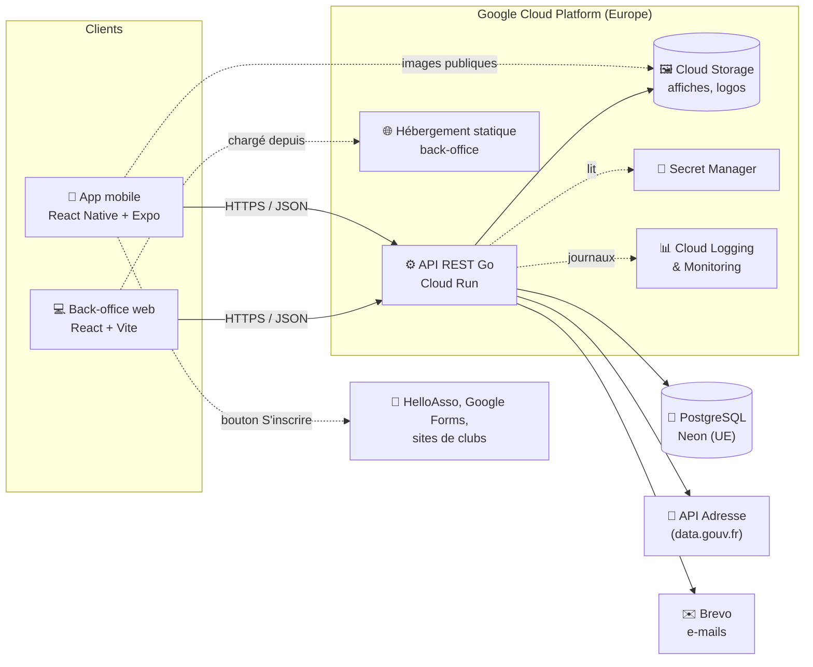
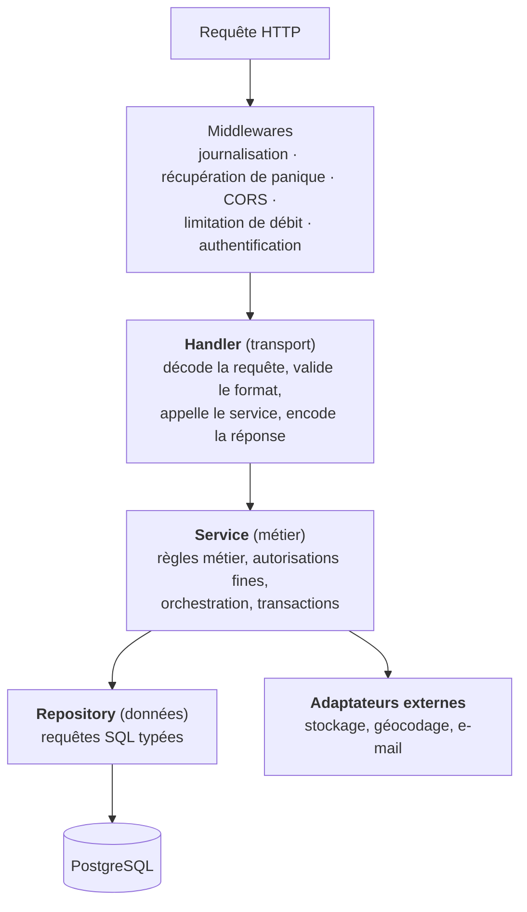
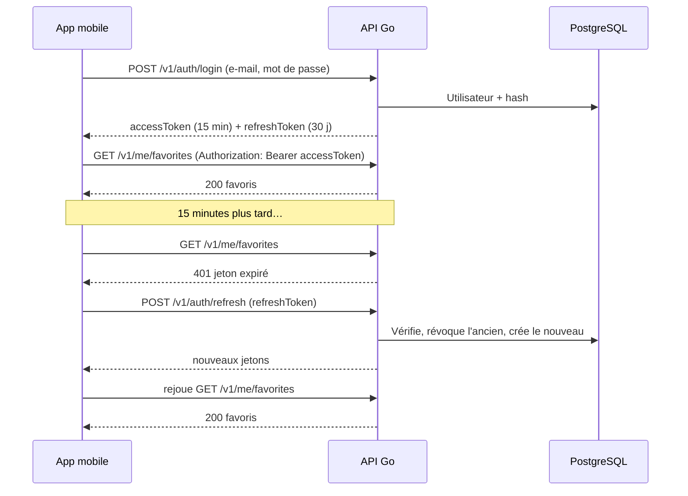
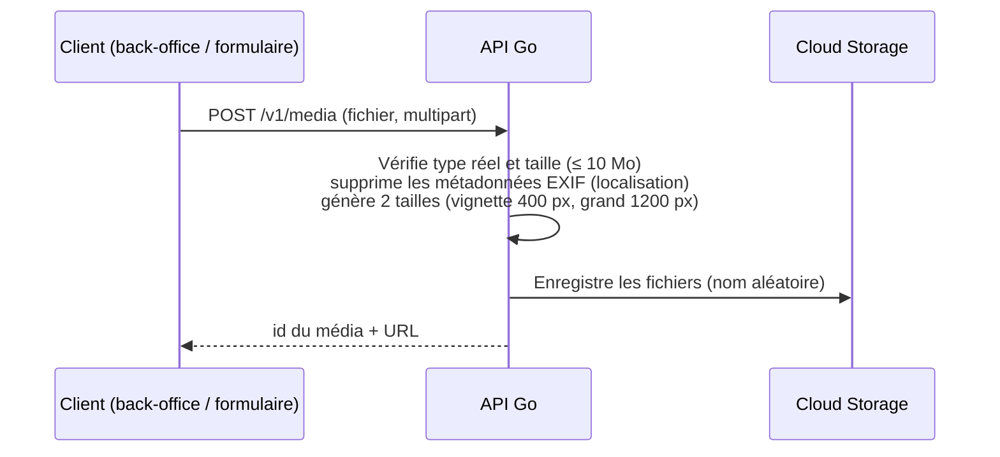
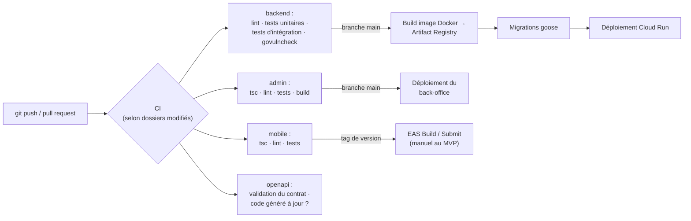

# Phase 2.1 — Architecture logicielle

| | |
|---|---|
| **Version** | 1.0 — à valider |
| **Date** | 1er novembre 2026 |
| **Référence** | [Cahier des charges v1.1](cahier-des-charges.md) |

> Ce document fixe **comment** le système est construit : composants, organisation du code, bibliothèques et conventions. Le modèle de données (2.2), le contrat d'API (2.3) et les maquettes (2.4) suivront, chacun validé séparément.

---

## Sommaire

1. [Principes directeurs](#1-principes-directeurs)
2. [Vue d'ensemble du système](#2-vue-densemble-du-système)
3. [Organisation du dépôt (monorepo)](#3-organisation-du-dépôt-monorepo)
4. [Backend Go](#4-backend-go)
5. [Application mobile](#5-application-mobile)
6. [Back-office web](#6-back-office-web)
7. [Authentification et autorisations](#7-authentification-et-autorisations)
8. [Médias (affiches et logos)](#8-médias-affiches-et-logos)
9. [Recherche et géographie](#9-recherche-et-géographie)
10. [Sécurité](#10-sécurité)
11. [Environnements, CI/CD et déploiement](#11-environnements-cicd-et-déploiement)
12. [Stratégie de tests](#12-stratégie-de-tests)
13. [Registre des décisions](#13-registre-des-décisions)
14. [Points à valider](#14-points-à-valider)

---

## 1. Principes directeurs

| Principe | Ce que cela signifie concrètement |
|---|---|
| **Simple d'abord** | Un seul backend (monolithe modulaire), une seule base, aucun microservice, aucune file de messages au MVP. |
| **Le contrat d'API est la source de vérité** | Le fichier OpenAPI est écrit en premier ; le code Go et les clients TypeScript en sont **générés**. Impossible que l'app et le serveur divergent sans erreur de compilation. |
| **Du SQL explicite** | Pas d'ORM : requêtes SQL écrites à la main, vérifiées et transformées en code Go typé. On apprend PostgreSQL au lieu de le cacher. |
| **Sécurisé par défaut** | Chaque route déclare qui peut l'appeler ; toute entrée est validée ; aucun secret dans le code. |
| **Testable** | Logique métier isolée de HTTP et de la base ; tests d'intégration sur un vrai PostgreSQL. |
| **Bibliothèque standard avant dépendance** | Une dépendance n'est ajoutée que si elle apporte un gain net et est largement maintenue. |
| **Évolutif sans surdimensionner** | Les besoins V2 (organisateurs, notifications, distance, inscriptions internes) sont **anticipés dans le modèle et les frontières de modules**, pas développés. |

---

## 2. Vue d'ensemble du système



**Points clés**

- **Une seule API** sert l'app mobile et le back-office ; les droits sont différenciés par rôle, pas par serveur.
- Les **images sont servies directement par Cloud Storage** (URL publiques, mises en cache), sans repasser par l'API : moins de charge, moins de coût.
- L'**inscription reste externe** : l'app ouvre simplement le lien dans le navigateur.
- Le géocodage d'adresse et l'envoi d'e-mails sont **appelés par le backend**, jamais par les clients (clés protégées, logique centralisée).

---

## 3. Organisation du dépôt (monorepo)

**Décision : un seul dépôt Git pour tout le projet.**

| | Monorepo (retenu) | Un dépôt par application |
|---|---|---|
| Changement d'API touchant backend + app | 1 commit cohérent | 2-3 commits coordonnés |
| Contrat OpenAPI partagé | Un seul fichier | Copié ou publié en paquet |
| CI | Un pipeline, filtré par dossier | Plusieurs pipelines |
| Adapté à un développeur seul | ✅ | ❌ surcoût de coordination |

```text
project/
├── api/
│   └── openapi.yaml            # Contrat d'API — source de vérité
├── backend/                    # API Go
├── mobile/                     # App React Native + Expo
├── admin/                      # Back-office React + Vite
├── docs/                       # Cahier des charges, conception, décisions
├── deploy/                     # Fichiers d'infrastructure (Cloud Run, scripts)
├── .github/workflows/          # CI/CD
├── docker-compose.yml          # PostgreSQL local pour le développement
└── README.md
```

Chaque dossier applicatif est autonome (ses propres dépendances, son propre README, ses propres commandes).

---

## 4. Backend Go

### 4.1 Architecture en couches



| Couche | Responsabilité | Ne fait **jamais** |
|---|---|---|
| **Handler** | Traduire HTTP ↔ Go : lire paramètres et corps, vérifier le format, convertir les erreurs en codes HTTP. | Contenir une règle métier ou du SQL. |
| **Service** | Appliquer les règles métier (RG-01 à RG-16 du cahier des charges), vérifier les droits fins (« cet organisateur peut-il modifier ce tournoi ? »), gérer les transactions. | Connaître HTTP (pas de `http.Request` ici). |
| **Repository** | Exécuter le SQL et renvoyer des structures Go. | Prendre une décision métier. |
| **Adaptateurs** | Encapsuler un service externe derrière une **interface** Go (ex. `Storage`, `Geocoder`, `Mailer`). | Être appelés directement depuis un handler. |

**Pourquoi des interfaces pour les adaptateurs ?** En test, on remplace Cloud Storage par un stockage en mémoire et Brevo par un faux expéditeur qui enregistre les e-mails : les tests sont rapides, gratuits et reproductibles.

### 4.2 Organisation des dossiers : par fonctionnalité

Plutôt que de regrouper tous les handlers ensemble, tous les services ensemble, etc., on regroupe **par domaine métier**. Chaque domaine contient ses propres couches.

```text
backend/
├── cmd/
│   └── api/
│       └── main.go                 # Point d'entrée : config, connexions, démarrage du serveur
├── internal/                       # Code privé à l'application (non importable de l'extérieur)
│   ├── config/                     # Lecture des variables d'environnement
│   ├── server/                     # Routeur, middlewares, branchement des modules
│   ├── platform/                   # Briques techniques partagées
│   │   ├── database/               #   pool de connexions, transactions
│   │   ├── httpx/                  #   erreurs HTTP standardisées, helpers JSON
│   │   ├── storage/                #   interface Storage + implémentations GCS / mémoire
│   │   ├── geocoding/              #   interface Geocoder + client API Adresse
│   │   ├── mailer/                 #   interface Mailer + client Brevo
│   │   └── logger/                 #   configuration de slog
│   ├── apigen/                     # Code GÉNÉRÉ depuis openapi.yaml (ne pas modifier)
│   ├── auth/                       # Inscription, connexion, jetons, mot de passe oublié
│   │   ├── handler.go
│   │   ├── service.go
│   │   ├── service_test.go
│   │   └── repository.go
│   ├── users/                      # Profil, suppression de compte
│   ├── geo/                        # Régions, départements, communes, lieux
│   ├── organizers/                 # Clubs et organisateurs
│   ├── tournaments/                # Séries, éditions, tableaux, recherche, duplication
│   ├── favorites/
│   ├── submissions/                # Propositions de tournois
│   ├── reports/                    # Signalements
│   ├── media/                      # Upload et traitement d'images
│   └── stats/                      # Compteurs vues / clics
├── db/
│   ├── migrations/                 # Migrations SQL versionnées (00001_init.sql, …)
│   ├── queries/                    # Requêtes SQL nommées, une par fichier de domaine
│   └── seeds/                      # Référentiels (régions, départements, communes, formats…)
├── sqlc.yaml                       # Configuration de génération du code SQL → Go
├── Dockerfile
├── Makefile                        # Commandes : make run, make test, make migrate, make generate
├── go.mod
└── README.md
```

**Avantage :** pour travailler sur les favoris, tout est dans `internal/favorites/`. Ajouter les inscriptions internes en V2 = ajouter un dossier `internal/registrations/`, sans toucher au reste.

### 4.3 Choix des bibliothèques

#### Routeur HTTP

| Option | Pour | Contre |
|---|---|---|
| `net/http` seul (Go ≥ 1.22) | Zéro dépendance, routage par méthode et paramètres natif | Middlewares par groupe de routes moins pratiques |
| **chi** ✅ | 100 % compatible `net/http`, groupes de routes et middlewares élégants, très léger, supporté par le générateur OpenAPI | Une petite dépendance |
| Gin / Echo / Fiber | Populaires, beaucoup d'exemples | API propre à chaque framework (s'éloigne de la bibliothèque standard), Fiber n'est même pas compatible `net/http` |

**Retenu : chi** — on reste sur les types standards de Go (ce qu'on apprend reste valable partout) avec le confort des groupes de routes (`/v1/admin/*` protégé d'un seul coup).

#### Accès à PostgreSQL

| Option | Pour | Contre |
|---|---|---|
| GORM (ORM) | Rapide pour un CRUD simple | Requêtes générées opaques, pièges de performance, mauvais pour apprendre SQL, recherche plein texte et requêtes géographiques maladroites |
| `database/sql` + SQL à la main | Contrôle total | Beaucoup de code répétitif pour lire les résultats, erreurs détectées seulement à l'exécution |
| **pgx + sqlc** ✅ | On écrit du SQL pur ; sqlc le vérifie contre le schéma et **génère des fonctions Go typées** ; pgx est le pilote PostgreSQL le plus performant et complet | Les requêtes très dynamiques (filtres combinables) demandent une technique particulière (voir ci-dessous) |

**Retenu : pgx v5 + sqlc.** Pour la recherche multi-filtres, on utilise le motif SQL `(@departement::text IS NULL OR departement = @departement)` qui reste statique et vérifiable ; si une requête devient trop dynamique, on la construit à la main dans le repository, de façon isolée.

#### Migrations de base de données

| Option | Pour | Contre |
|---|---|---|
| golang-migrate | Très répandu | Deux fichiers par migration (up/down), pas de migrations en Go |
| **goose** ✅ | Un fichier SQL par migration (sections up/down), utilisable en ligne de commande **et** depuis Go, lit le même dossier que sqlc | — |
| Atlas | Migrations déclaratives puissantes | Plus complexe, surdimensionné ici |

**Retenu : goose.** Les migrations sont exécutées par une étape dédiée du déploiement (pas au démarrage de chaque instance, pour éviter les exécutions concurrentes sur Cloud Run).

#### Documentation et contrat d'API

| Option | Pour | Contre |
|---|---|---|
| swaggo (annotations dans le code Go → Swagger) | Rapide à démarrer | La doc dérive du code facilement, OpenAPI 2.0 seulement, pas de garantie de cohérence |
| **Contrat d'abord : `openapi.yaml` + oapi-codegen** ✅ | Le contrat est écrit et validé **avant** le code ; génère les types et l'interface du serveur Go ; le compilateur refuse un handler qui ne respecte pas le contrat ; même fichier pour générer le client TypeScript | Il faut apprendre la syntaxe OpenAPI (je fournirai le fichier complet en 2.3) |

**Retenu : approche « contrat d'abord » avec oapi-codegen** (mode *strict server* sur chi). La documentation interactive (Swagger UI / Scalar) est servie sur `/docs` en développement.

#### Validation des données

- **Format** (types, champs requis, longueurs, énumérations, formats e-mail/URL/date) : déclaré dans `openapi.yaml` et vérifié automatiquement par un middleware de validation de requête (`kin-openapi`). Une seule déclaration, appliquée partout.
- **Règles métier** (date de fin ≥ date de début, au moins un tableau, URL obligatoire si inscription par lien, transitions de statut autorisées…) : vérifiées **dans les services**, en Go explicite, testées unitairement.

Pas de bibliothèque de validation par annotations (`go-playground/validator`) : ce serait un troisième endroit où décrire les règles.

#### Autres briques

| Besoin | Choix | Raison |
|---|---|---|
| Configuration | Variables d'environnement lues par `caarlos0/env` | Standard sur Cloud Run (12-factor) ; secrets injectés depuis Secret Manager |
| Journalisation | `log/slog` (bibliothèque standard), format JSON | Directement compris par Cloud Logging (niveau, trace, champs structurés) |
| Hachage des mots de passe | Argon2id (`golang.org/x/crypto/argon2`) | Recommandation OWASP actuelle |
| Jetons d'accès | JWT signés (`golang-jwt/jwt/v5`) | Vérification sans requête en base |
| Images | `disintegration/imaging` | Redimensionnement en Go pur (voir section 8) |
| Tests base de données | `testcontainers-go` | Lance un vrai PostgreSQL jetable dans Docker pendant les tests |
| Lint | `golangci-lint` | Ensemble de vérificateurs standard de la communauté |

### 4.4 Gestion des erreurs

1. Les services renvoient des **erreurs métier typées** définies une fois pour toutes :
   `ErrNotFound`, `ErrConflict` (ex. e-mail déjà utilisé), `ErrValidation` (avec la liste des champs fautifs), `ErrUnauthorized`, `ErrForbidden`, `ErrRateLimited`.
2. Un **seul endroit** (`platform/httpx`) traduit ces erreurs en réponses HTTP au format standard **RFC 9457 « Problem Details »** :

```json
{
  "type": "https://volleyspot.app/errors/validation",
  "title": "Données invalides",
  "status": 422,
  "detail": "La date de fin doit être postérieure à la date de début.",
  "errors": [{ "field": "endDate", "message": "doit être ≥ startDate" }],
  "requestId": "c0a8012e-…"
}
```

3. Toute erreur inattendue renvoie un `500` **générique** au client (aucun détail technique divulgué) et est journalisée côté serveur avec la pile d'appels et l'identifiant de requête.
4. Chaque requête reçoit un **identifiant unique** (`X-Request-ID`) présent dans les journaux et dans les réponses d'erreur : un utilisateur qui signale un bug donne cet identifiant, on retrouve la trace en une recherche.

### 4.5 Conventions de l'API REST

| Sujet | Convention |
|---|---|
| Préfixe et version | `/v1/...` |
| Espaces | Public (`/v1/tournaments`), utilisateur (`/v1/me/...`), administration (`/v1/admin/...`) |
| Format | JSON, champs en `camelCase`, dates ISO 8601 (`2027-06-14`, horodatages en UTC) |
| Pagination | Par curseur (`?cursor=…&limit=20`) : stable même si des tournois sont ajoutés pendant le défilement |
| Filtres | Paramètres de requête (`?department=29&format=2x2&surface=sand&from=2027-06-01`) |
| Codes HTTP | `200`, `201` (création), `204` (suppression), `400`/`422` (invalide), `401`, `403`, `404`, `409`, `429`, `500` |
| Mise en cache | En-têtes `Cache-Control` / `ETag` sur les listes publiques et référentiels |

Le détail des routes sera défini dans le document 2.3.

---

## 5. Application mobile

### 5.1 Pile technique

| Besoin | Choix | Raison |
|---|---|---|
| Socle | **Expo (SDK stable le plus récent) + TypeScript strict** | Build Android/iOS dans le cloud, test immédiat via Expo Go |
| Navigation | **Expo Router** | Navigation par fichiers (un fichier = un écran), liens profonds automatiques (partage d'un tournoi → ouvre la fiche) |
| Appels API et cache | **TanStack Query** + client **généré depuis openapi.yaml** (`openapi-typescript` + `openapi-fetch`) | Cache, rechargement, pagination infinie, mises à jour optimistes (favoris) prêts à l'emploi ; types garantis conformes au backend |
| État local | `useState` / contexte React ; **Zustand** seulement si nécessaire (filtres) | Éviter Redux, inutile ici |
| Stockage sécurisé | **expo-secure-store** | Jetons de connexion chiffrés par le système (Keystore Android / Keychain iOS) |
| Préférences | AsyncStorage | Derniers filtres, département préféré |
| Formulaires | **react-hook-form + zod** | Validation côté client avant envoi (proposition, inscription) |
| Images | **expo-image** | Cache disque, chargement progressif |
| Style | `StyleSheet` + **jetons de design** maison (couleurs, espacements, typographie) avec thème clair/sombre | Léger, pas de dépendance UI lourde ; base de la charte définie en 2.4 |
| Tests | **Jest + React Native Testing Library** | Standard Expo |
| Qualité | ESLint + Prettier + `tsc --noEmit` en CI | |

### 5.2 Organisation

```text
mobile/
├── app/                        # Écrans (Expo Router) — l'arborescence = la navigation
│   ├── (tabs)/
│   │   ├── index.tsx           # Tournois (accueil)
│   │   ├── favorites.tsx       # Mes tournois
│   │   ├── submit.tsx          # Proposer
│   │   └── profile.tsx         # Profil
│   ├── tournament/[id].tsx     # Fiche tournoi
│   ├── organizer/[id].tsx      # Fiche organisateur
│   └── auth/                   # Connexion, inscription, mot de passe oublié
├── src/
│   ├── api/                    # Client généré + hooks TanStack Query (useTournaments, useFavorites…)
│   ├── components/             # Composants réutilisables (TournamentCard, FilterSheet, Badge…)
│   ├── features/               # Logique par domaine (auth, filters…)
│   ├── theme/                  # Jetons de design, thèmes clair/sombre
│   └── i18n/                   # Textes en français (externalisés)
├── assets/                     # Icônes, visuels génériques (sable, salle, extérieur)
├── app.config.ts
└── package.json
```

---

## 6. Back-office web

| Besoin | Choix | Raison |
|---|---|---|
| Socle | **React + Vite + TypeScript** | Mêmes compétences que le mobile |
| Composants d'interface | **Mantine** | Tableaux, formulaires, sélecteurs de date, upload, notifications, prêts et accessibles : un back-office complet sans écrire de CSS |
| Navigation | React Router | Standard |
| API | TanStack Query + **même client généré** que le mobile | Zéro duplication |
| Formulaires | react-hook-form + zod (ou formulaires Mantine) | Saisie rapide et validée (objectif < 2 min par tournoi) |
| Hébergement | Fichiers statiques (Firebase Hosting ou Cloud Storage + CDN) | Gratuit, HTTPS automatique |

Le back-office est une application séparée mais **ne contient aucune logique métier** : il appelle `/v1/admin/*`, et c'est l'API qui applique les règles.

---

## 7. Authentification et autorisations

### 7.1 Mécanisme

| Élément | Choix |
|---|---|
| Identifiants | E-mail + mot de passe (≥ 10 caractères), haché en **Argon2id** |
| Jeton d'accès | **JWT** signé, durée **15 minutes**, contient l'identifiant et le rôle |
| Jeton de renouvellement | Chaîne aléatoire opaque, durée **30 jours**, stockée **hachée** en base, **rotation à chaque usage** (un jeton volé et réutilisé révoque toute la session) |
| Stockage côté mobile | expo-secure-store |
| Stockage côté back-office | Jeton d'accès en mémoire ; jeton de renouvellement en **cookie `HttpOnly`, `Secure`, `SameSite=Strict`** (inaccessible au JavaScript, donc protégé du vol par XSS) |
| Vérification d'e-mail | Lien à usage unique (24 h) envoyé à l'inscription ; les favoris fonctionnent avant vérification, la vérification est requise pour réinitialiser le mot de passe |
| Mot de passe oublié | Lien à usage unique (1 h), réponse identique que l'e-mail existe ou non (pas de fuite d'information) |
| Déconnexion | Révocation du jeton de renouvellement |
| Suppression de compte | Suppression des données + révocation de toutes les sessions |



**Pourquoi ne pas utiliser Firebase Auth ou Supabase Auth ?** Ce serait plus rapide à mettre en place, mais : (1) l'authentification est un excellent sujet d'apprentissage backend, (2) on garde la maîtrise totale des données (RGPD, hébergement UE), (3) pas de dépendance à un fournisseur. Contrepartie assumée : plus de code à écrire et à tester soigneusement. **Pour la V2 (Google / Apple),** on vérifiera les jetons d'identité Google/Apple côté backend et on les rattachera au même modèle d'utilisateur.

### 7.2 Autorisations

- **Niveau 1 — par route** : un middleware vérifie le rôle requis (`public`, `user`, `admin`, `organizer`). Toutes les routes `/v1/admin/*` exigent `admin` en un seul point.
- **Niveau 2 — par ressource** (dans les services) : « cet utilisateur peut-il modifier **ce** tournoi ? ». Inutile au MVP (seul l'admin modifie), mais l'emplacement est prévu pour le rôle organisateur en V2.

---

## 8. Médias (affiches et logos)



| Sujet | Décision |
|---|---|
| Passage par l'API | Oui au MVP (plus simple à sécuriser et à valider). Les URL signées d'upload direct vers Cloud Storage sont une optimisation possible plus tard. |
| Vérification | Type déterminé par le **contenu** du fichier, pas par son extension ; formats acceptés JPEG, PNG, WebP. |
| Traitement | Redimensionnement en Go pur, sortie JPEG qualité ~82 (Go ne sait pas encoder le WebP sans bibliothèque C ; le gain du WebP ne justifie pas cette complexité au MVP). Suppression des métadonnées EXIF. |
| Nommage | Identifiant aléatoire (UUID), jamais le nom d'origine. |
| Accès | Lecture publique via URL directe Cloud Storage avec cache long ; écriture uniquement par l'API. |
| Propositions | Les affiches jointes à une proposition sont stockées dans un dossier « en attente », non publiques tant que la proposition n'est pas validée. |

---

## 9. Recherche et géographie

| Besoin | Solution PostgreSQL | Pourquoi |
|---|---|---|
| Recherche texte (nom, organisateur, ville), insensible aux accents | Extensions **`unaccent`** + **`pg_trgm`** (recherche par similarité, tolère les fautes de frappe : « plouharnel » trouve « Plouharnel ») | Suffisant et très performant pour quelques milliers de tournois ; aucun moteur de recherche externe (Elasticsearch, Algolia) nécessaire |
| Filtres combinés | Index B-tree sur dates, département ; requête par tableaux (un tournoi correspond si un de ses tableaux correspond) | Détaillé en 2.2 |
| Coordonnées GPS | Stockées dès le MVP (latitude / longitude), obtenues par l'**API Adresse** à la saisie | Indispensable pour la distance et la carte en V2 |
| Distance « autour de moi » (V2) | Extension **PostGIS** (disponible sur Neon et Cloud SQL) | Standard du domaine ; activée en V2 sans changer les données |
| Référentiel géographique | Régions, départements et communes issus des **données officielles INSEE / API Géo**, chargés par un script de seed | Données fiables et à jour, codes officiels |

---

## 10. Sécurité

| Menace | Mesure |
|---|---|
| Interception | HTTPS obligatoire (Cloud Run le fournit), HSTS |
| Vol de mots de passe | Argon2id, jamais journalisés |
| Force brute / abus | Limitation de débit par IP sur connexion, inscription, mot de passe oublié, propositions, signalements |
| Spam des formulaires anonymes | Limitation de débit + champ « pot de miel » invisible ; ajout de **Cloudflare Turnstile** (gratuit) uniquement si du spam apparaît |
| Injection SQL | Requêtes paramétrées générées par sqlc (aucune concaténation de chaînes) |
| XSS (back-office) | React échappe par défaut ; description affichée en texte brut (pas de HTML), en-têtes de sécurité (CSP) |
| Accès non autorisé | Middleware de rôle sur chaque groupe de routes ; tests automatiques qui vérifient qu'un utilisateur non admin reçoit `403` sur chaque route admin |
| Fichiers malveillants | Vérification du type réel, taille limitée, ré-encodage systématique des images |
| CORS | Seul le domaine du back-office est autorisé pour les appels depuis un navigateur |
| Secrets | Secret Manager en production, fichier `.env` local **exclu de Git** |
| Dépendances vulnérables | `govulncheck` (Go) et Dependabot en CI |
| Fuite d'informations | Erreurs `500` génériques ; pas de détails techniques renvoyés |

> **Note sur la limitation de débit :** au MVP elle est en mémoire, par instance Cloud Run. Avec le trafic attendu (une instance la plupart du temps), c'est suffisant. Si plusieurs instances deviennent la norme, on la déplacera en base ou dans un cache partagé.

---

## 11. Environnements, CI/CD et déploiement

### 11.1 Environnements

| Environnement | Composition | Usage |
|---|---|---|
| **Local** | API Go lancée sur le poste + PostgreSQL dans Docker (`docker compose up`) + app sur téléphone via Expo Go + back-office en `npm run dev` | Développement quotidien |
| **Production** | Cloud Run + Neon (branche `main`) + Cloud Storage + back-office hébergé | Utilisateurs réels |
| **Préproduction** | *Non créée au MVP.* Neon permet de créer une base de test en un clic (« branche ») si besoin | — |

> **Prérequis sur Windows :** VS Code, Git, Go, Node.js LTS, Docker Desktop (avec WSL 2). La procédure d'installation détaillée sera fournie au début de la phase 3.

### 11.2 Pipeline

**Décision : GitHub Actions** pour l'intégration et le déploiement continus (plutôt que Cloud Build).

| | **GitHub Actions** ✅ | Cloud Build |
|---|---|---|
| Intégration avec le dépôt | Native (le code est sur GitHub) : résultats des tests sur chaque commit et pull request | Nécessite un connecteur |
| Gratuit | Oui (dépôt public : illimité) | 120 min/jour gratuites |
| Déploiement vers GCP | Via **Workload Identity Federation** : aucune clé de compte de service stockée | Natif |
| Écosystème | Très large (actions Expo, Go, Node…) | Plus restreint |



**Règle de travail Git** : la branche `main` est toujours déployable ; chaque fonctionnalité est développée sur une branche, fusionnée après passage de la CI.

---

## 12. Stratégie de tests

| Niveau | Quoi | Outils | Cible |
|---|---|---|---|
| **Unitaires backend** | Services (règles métier), avec dépôts et adaptateurs simulés | `testing` (standard) | ≥ 70 % de couverture des services |
| **Intégration backend** | Repositories sur un vrai PostgreSQL ; endpoints HTTP de bout en bout (requête → base → réponse) | `testcontainers-go`, `httptest` | Chaque endpoint MVP, chaque contrôle de rôle |
| **Contrat** | Les réponses de l'API respectent `openapi.yaml` | Validation automatique en test | Toutes les routes |
| **Mobile** | Composants clés (carte tournoi, filtres, formulaire), hooks | Jest + Testing Library | Parcours critiques |
| **Back-office** | Formulaire tournoi, files de modération | Vitest + Testing Library | Parcours critiques |
| **Manuels / bêta** | Parcours complets sur téléphone réel | Expo Go puis build de test Google Play | Phase 7 |

---

## 13. Registre des décisions

| # | Décision | Alternative écartée | Raison principale |
|---|---|---|---|
| D-01 | Monolithe modulaire Go | Microservices | Un développeur, faible trafic : la complexité n'apporte rien |
| D-02 | Monorepo | Dépôts séparés | Contrat partagé, changements atomiques |
| D-03 | Contrat OpenAPI d'abord + génération de code | Annotations swaggo | Cohérence garantie par le compilateur |
| D-04 | chi | Gin, Echo, Fiber | Compatible bibliothèque standard |
| D-05 | pgx + sqlc | GORM | SQL explicite, typé, performant |
| D-06 | goose | golang-migrate, Atlas | Simple, SQL pur, utilisable depuis Go |
| D-07 | Organisation par fonctionnalité | Organisation par couche technique | Cohésion, évolutivité |
| D-08 | Authentification maison (JWT court + jeton de renouvellement rotatif) | Firebase Auth, Supabase Auth | Apprentissage, maîtrise des données |
| D-09 | Recherche PostgreSQL (`pg_trgm`, `unaccent`) | Elasticsearch, Algolia | Volume faible, zéro infrastructure en plus |
| D-10 | Coordonnées GPS dès le MVP, PostGIS en V2 | PostGIS dès le MVP | Pas de besoin de calcul géographique au MVP |
| D-11 | Upload d'images via l'API | URL signées directes | Simplicité et contrôle au MVP |
| D-12 | Expo Router + TanStack Query + client généré | React Navigation + Redux | Moins de code, typage de bout en bout |
| D-13 | Mantine pour le back-office | Tailwind / shadcn, Material UI | Composants de back-office complets prêts à l'emploi |
| D-14 | GitHub Actions + Workload Identity Federation | Cloud Build | Intégration native au dépôt, pas de clé stockée |
| D-15 | Erreurs au format RFC 9457 | Format maison | Standard, compris par les outils |

---

## 14. Points à valider

1. **Contrat OpenAPI d'abord** (D-03) : vous écrirez moins de code « de plomberie », mais il faudra lire un fichier YAML d'API. Je le fournis complet et commenté en 2.3. → OK ?
2. **Authentification maison** (D-08) plutôt qu'un service clé en main. → OK ?
3. **Mantine** pour le back-office (D-13). → OK ?
4. **GitHub Actions** plutôt que Cloud Build (D-14), Cloud Run et le reste de GCP étant inchangés. → OK ?
5. Le reste du document (structure, bibliothèques, sécurité, tests) vous convient-il ?

Après validation : **2.2 — Modèle de données** (diagramme entité-association, contraintes, index, puis scripts SQL commentés).
