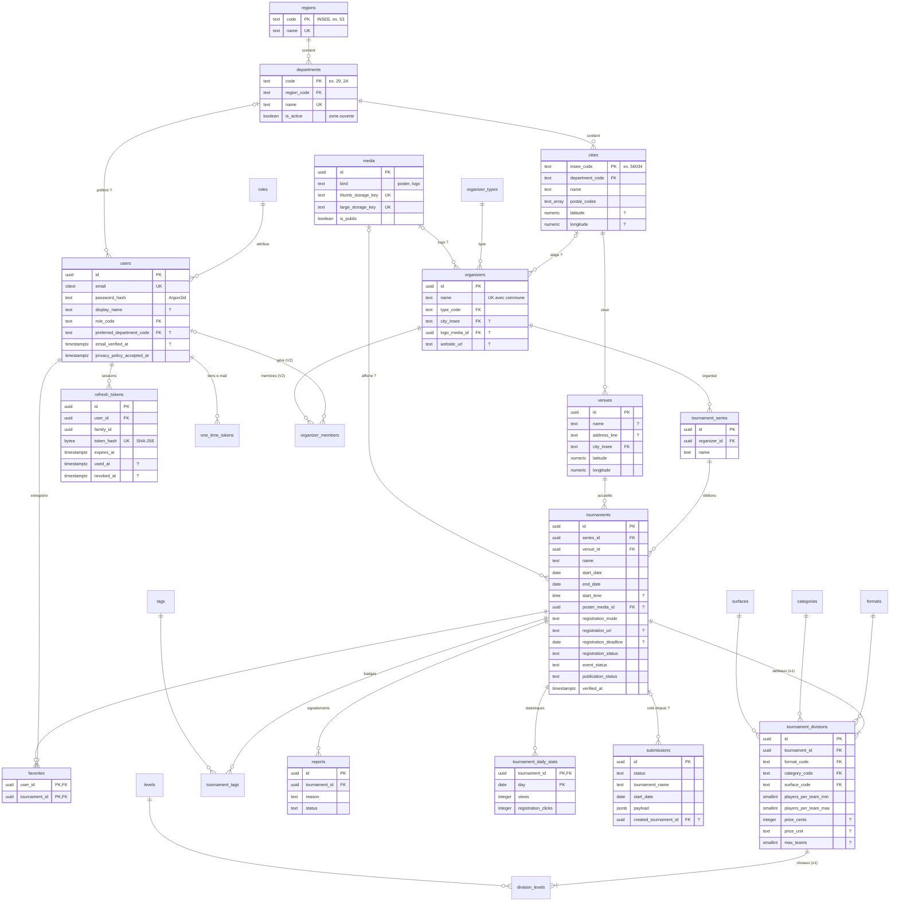

# Phase 2.2 — Modèle de données PostgreSQL

| | |
|---|---|
| **Version** | 1.0 — validée |
| **Date** | 1er novembre 2026 |
| **Références** | [Cahier des charges v1.1](cahier-des-charges.md) · [Architecture 2.1](02-architecture.md) |
| **Scripts SQL** | [`backend/db/migrations/`](../backend/db/migrations) · [`backend/db/seeds/dev_seed.sql`](../backend/db/seeds/dev_seed.sql) |

> Les scripts ont été **exécutés et testés** sur PostgreSQL 16 (compatible 17, version proposée par Neon) : migrations montantes et descendantes, chargement des données de test (rejouable), 16 tests de contraintes, suppression RGPD d'un compte et requête de recherche complète. Voir [section 9](#9-vérifications-effectuées).

---

## Sommaire

1. [Choix de modélisation](#1-choix-de-modélisation)
2. [Diagramme entité-association](#2-diagramme-entité-association)
3. [Dictionnaire des tables](#3-dictionnaire-des-tables)
4. [Relations et comportements à la suppression](#4-relations-et-comportements-à-la-suppression)
5. [Contraintes d'intégrité métier](#5-contraintes-dintégrité-métier)
6. [Index](#6-index)
7. [Requête de recherche des tournois](#7-requête-de-recherche-des-tournois)
8. [Données personnelles et rétention (RGPD)](#8-données-personnelles-et-rétention-rgpd)
9. [Vérifications effectuées](#9-vérifications-effectuées)
10. [Évolutions prévues](#10-évolutions-prévues)
11. [Points à valider](#11-points-à-valider)

---

## 1. Choix de modélisation

| # | Sujet | Décision | Pourquoi |
|---|---|---|---|
| M-01 | **Identifiants** | `uuid` (générés par `gen_random_uuid()`) pour toutes les entités exposées par l'API ; codes officiels pour la géographie ; codes texte lisibles pour les référentiels ; `bigint` séquentiel pour le journal d'audit | Un UUID ne révèle ni le volume ni l'ordre de création (impossible de « deviner » `/tournaments/124`) et peut être généré côté client si besoin. Les codes texte (`'2x2'`, `'sand'`) rendent les données lisibles et les requêtes explicites. |
| M-02 | **Valeurs listables** (formats, catégories, niveaux, terrains, badges, types d'organisateur, rôles) | **Tables de référence** avec clé texte | Ajouter une valeur = un `INSERT`, sans migration de type. Le back-office peut lister les valeurs via l'API. Les clés étrangères garantissent qu'aucune valeur inconnue n'est enregistrée. |
| M-03 | **Statuts** (publication, déroulement, inscriptions, modération) | Colonnes `text` + contrainte `CHECK` | Liés à la logique du code (machine à états) : ils ne doivent pas être modifiables par les données. Plus simples à faire évoluer que les types `ENUM` PostgreSQL. |
| M-04 | **Série / édition / tableaux** | Trois tables : `tournament_series` → `tournaments` → `tournament_divisions` | Règles RG-01 et RG-02 : duplication annuelle, plusieurs tableaux par tournoi, filtres précis par tableau. |
| M-05 | **Dates** | `date` + `time` (heure locale française) pour les tournois ; `timestamptz` (UTC) pour les horodatages techniques | Un tournoi « le 14 juin à 9 h » est une date locale, pas un instant universel ; toute la zone est sur le même fuseau horaire. |
| M-06 | **Prix** | Entier en **centimes** + unité (`team` / `player`) ; `NULL` = non communiqué, `0` = gratuit | Aucune erreur d'arrondi (les `float` sont à proscrire pour l'argent). |
| M-07 | **Coordonnées GPS** | `numeric(8,6)` / `numeric(9,6)` (précision ≈ 10 cm) sur les lieux et les communes | Suffisant pour la V2 (distance) ; passage à PostGIS sans changer les données. |
| M-08 | **Images** | Table `media` : métadonnées + clés de stockage Cloud Storage (jamais le fichier en base) | Base légère, images servies par le CDN. |
| M-09 | **Liens externes** | `text` + contrainte `^https?://` + longueur maximale | Empêche les liens dangereux (`javascript:`…) dès la base ; validation fine dans l'API. |
| M-10 | **Recherche texte** | Fonction `search_normalize()` (minuscules + sans accents, `IMMUTABLE`) + index trigrammes `pg_trgm` | Recherche insensible à la casse et aux accents, tolérante aux fautes, accélérée par index. |
| M-11 | **`updated_at`** | Déclencheur `set_updated_at()` sur chaque table modifiable | Impossible d'oublier de le mettre à jour dans le code. |
| M-12 | **Suppression** | Suppressions **physiques** ; les tournois publiés ne sont jamais supprimés mais archivés (statut) | Simple et conforme au RGPD (effacement réel des comptes). L'archivage couvre le besoin d'historique. |
| M-13 | **Inscriptions internes** | **Aucune table** au MVP | Rien à stocker tant que l'inscription est externe ; la future table `registrations` se rattachera à `tournament_divisions` sans rien modifier d'autre. |

---

## 2. Diagramme entité-association

Légende : `PK` clé primaire · `FK` clé étrangère · `UK` unique · « `?` » dans la description = facultatif.



> Le journal d'audit (`audit_log`) n'est pas représenté : il référence n'importe quelle entité par `(entity_type, entity_id)` et l'auteur par `actor_user_id`.

---

## 3. Dictionnaire des tables

**22 tables**, réparties en 6 migrations goose.

| Migration | Tables |
|---|---|
| `00001_extensions_and_functions` | Extensions `citext`, `unaccent`, `pg_trgm` ; fonctions `search_normalize()`, `set_updated_at()` |
| `00002_reference_data` | `roles`, `formats`, `categories`, `levels`, `surfaces`, `tags`, `organizer_types`, `regions`, `departments`, `cities` |
| `00003_users_and_auth` | `users`, `refresh_tokens`, `one_time_tokens` |
| `00004_media_and_organizers` | `media`, `organizers`, `organizer_members`, `venues` |
| `00005_tournaments` | `tournament_series`, `tournaments`, `tournament_divisions`, `division_levels`, `tournament_tags` |
| `00006_engagement_and_moderation` | `favorites`, `submissions`, `reports`, `tournament_daily_stats`, `audit_log` |

### 3.1 Référentiels (remplis par la migration)

| Table | Valeurs |
|---|---|
| `roles` | `user`, `organizer` (V2), `admin` |
| `formats` | `2x2`, `3x3`, `4x4`, `6x6`, `other` (avec nombre de joueurs sur le terrain) |
| `categories` | `men` (Masculin), `women` (Féminin), `mixed` (Mixte), `open` (Libre) |
| `levels` | `beginner`, `leisure`, `intermediate`, `advanced`, `competitive` (ordonnés) |
| `surfaces` | `indoor` (Intérieur), `outdoor` (Extérieur), `sand` (Sable) |
| `tags` | `charity`, `telethon`, `solidarity`, `special` — « Bientôt clôturées » est **calculé** (RG-08) |
| `organizer_types` | `club`, `association`, `municipality`, `business`, `individual`, `other` |
| `regions` | 13 régions métropolitaines |
| `departments` | 96 départements ; `is_active = true` pour **22, 29, 35, 44, 56** |
| `cities` | Vide après migration : import des ~35 000 communes par script (phase 3) |

### 3.2 Tables métier — champs obligatoires et facultatifs

#### `users`

| Colonne | Type | Oblig. | Règles |
|---|---|:-:|---|
| `id` | uuid | ✅ | PK, générée |
| `email` | citext | ✅ | Unique, insensible à la casse, ≤ 254 caractères |
| `password_hash` | text | ✅ | Argon2id (format PHC) |
| `display_name` | text | | 2 à 50 caractères |
| `role_code` | text | ✅ | FK `roles`, défaut `user` |
| `preferred_department_code` | text | | FK `departments` |
| `email_verified_at` | timestamptz | | |
| `privacy_policy_accepted_at` | timestamptz | ✅ | Preuve de consentement |
| `last_login_at` | timestamptz | | |
| `created_at`, `updated_at` | timestamptz | ✅ | Automatiques |

#### `organizers`

| Colonne | Type | Oblig. | Règles |
|---|---|:-:|---|
| `id` | uuid | ✅ | PK |
| `name` | text | ✅ | 2 à 150 caractères ; **unique par commune** (insensible casse et accents) |
| `type_code` | text | ✅ | FK `organizer_types`, défaut `club` |
| `description` | text | | ≤ 5 000 caractères |
| `city_insee` | text | | FK `cities` |
| `logo_media_id` | uuid | | FK `media` |
| `email`, `phone` | citext, text | | Format vérifié |
| `website_url`, `facebook_url`, `instagram_url` | text | | `http(s)://` |
| `created_by` | uuid | | FK `users` |

#### `venues` (lieux)

| Colonne | Type | Oblig. | Règles |
|---|---|:-:|---|
| `id` | uuid | ✅ | PK |
| `name` | text | | Ex. « Grande Plage » |
| `address_line` | text | | ≤ 250 caractères |
| `postal_code` | text | | 5 chiffres |
| `city_insee` | text | ✅ | FK `cities` |
| `latitude`, `longitude` | numeric | ✅ | Bornes géographiques vérifiées |
| `geocoding_source` | text | ✅ | `ban` (adresse précise), `city_center`, `manual` |

#### `tournament_series`

| Colonne | Type | Oblig. | Règles |
|---|---|:-:|---|
| `id` | uuid | ✅ | PK |
| `organizer_id` | uuid | ✅ | FK `organizers` |
| `name` | text | ✅ | 2 à 150 caractères |

#### `tournaments` (éditions)

| Colonne | Type | Oblig. | Règles |
|---|---|:-:|---|
| `id` | uuid | ✅ | PK |
| `series_id` | uuid | ✅ | FK `tournament_series` |
| `name` | text | ✅ | 2 à 150 caractères |
| `venue_id` | uuid | ✅ | FK `venues` |
| `start_date`, `end_date` | date | ✅ | `end_date ≥ start_date` (le service met `end_date = start_date` par défaut) |
| `start_time` | time | | |
| `poster_media_id` | uuid | | FK `media` (visuel générique sinon) |
| `description` | text | | ≤ 10 000 caractères |
| `rules_text` / `rules_url` | text | | Règlement en texte ou en lien |
| `registration_mode` | text | ✅ | `external_link`, `on_site`, `phone_or_email` |
| `registration_url` | text | si lien externe | `http(s)://`, ≤ 2 000 caractères |
| `registration_instructions` | text | | Consigne si pas de lien |
| `registration_deadline` | date | | ≤ `end_date` ; sert au badge calculé |
| `registration_status` | text | ✅ | `not_open_yet` (défaut), `open`, `full`, `closed` |
| `event_status` | text | ✅ | `scheduled` (défaut), `postponed`, `cancelled` |
| `postponed_to_date` | date | | Uniquement si `postponed` |
| `publication_status` | text | ✅ | `draft` (défaut), `pending`, `published`, `rejected`, `archived` |
| `rejection_reason` | text | si refusé | |
| `published_at` | timestamptz | si publié/archivé | |
| `contact_email`, `contact_phone`, `contact_url` | | | Format vérifié |
| `verified_at` | timestamptz | ✅ | Date « Vérifié le » |
| `source_note` | text | | **Interne**, jamais exposée par l'API publique |
| `created_by`, `updated_by` | uuid | | FK `users` |

#### `tournament_divisions` (tableaux) et `division_levels`

| Colonne | Type | Oblig. | Règles |
|---|---|:-:|---|
| `id` | uuid | ✅ | PK |
| `tournament_id` | uuid | ✅ | FK `tournaments` (suppression en cascade) |
| `position` | smallint | ✅ | Ordre d'affichage |
| `format_code`, `category_code`, `surface_code` | text | ✅ | FK vers les référentiels |
| `players_per_team_min` / `_max` | smallint | ✅ | 1 à 12, min ≤ max |
| `price_cents` | integer | | `NULL` non communiqué, `0` gratuit, ≤ 1 000 € |
| `price_unit` | text | si payant | `team` ou `player` |
| `max_teams` | smallint | | 1 à 1 000 |
| `schedule_note`, `conditions` | text | | Horaire libre, conditions particulières |
| **`division_levels`** | | | (`division_id`, `level_code`) — un tableau accepte **un ou plusieurs niveaux** |

#### Autres tables

| Table | Rôle | Points clés |
|---|---|---|
| `refresh_tokens` | Sessions | Empreinte SHA-256 uniquement ; `family_id` pour révoquer toute une chaîne si un jeton volé est réutilisé |
| `one_time_tokens` | Liens par e-mail | `purpose` = `email_verification` ou `password_reset` ; usage unique (`used_at`) |
| `media` | Images | Deux variantes (vignette, grand format) ; `is_public = false` tant qu'une proposition n'est pas validée |
| `organizer_members` | V2 | Lien utilisateur ↔ organisateur ; vide au MVP |
| `tournament_tags` | Badges manuels | (`tournament_id`, `tag_code`) |
| `favorites` | Favoris | Clé primaire composite : doublon impossible |
| `submissions` | Propositions | Champs clés structurés + formulaire complet en `jsonb` ; lien vers le tournoi créé |
| `reports` | Signalements | Motif parmi 5 valeurs ; statut `open` / `resolved` / `dismissed` |
| `tournament_daily_stats` | Statistiques | Une ligne par tournoi et par jour, incrémentée par *upsert* |
| `audit_log` | Historique | Qui, quoi, quand, avec le détail des changements en `jsonb` |

---

## 4. Relations et comportements à la suppression

| Relation | Cardinalité | À la suppression du parent | Justification |
|---|---|---|---|
| `regions` → `departments` → `cities` | 1–N | Interdite (`RESTRICT` par défaut) | Référentiel stable |
| `cities` → `venues` | 1–N | Interdite | |
| `organizers` → `tournament_series` | 1–N | **Interdite** | On ne perd pas des tournois en supprimant un organisateur par erreur |
| `tournament_series` → `tournaments` | 1–N | **Interdite** | Idem |
| `venues` → `tournaments` | 1–N | Interdite | |
| `tournaments` → `tournament_divisions` → `division_levels` | 1–N | **Cascade** | Un tableau n'existe pas sans son tournoi |
| `tournaments` → `tournament_tags`, `favorites`, `reports`, `tournament_daily_stats` | 1–N | Cascade | Données dépendantes |
| `tournaments` → `submissions.created_tournament_id` | 1–N | `SET NULL` | La proposition reste dans l'historique |
| `users` → `refresh_tokens`, `one_time_tokens`, `favorites`, `organizer_members` | 1–N | **Cascade** | Effacement RGPD complet |
| `users` → `created_by`, `updated_by`, `reviewed_by`, `resolved_by`, `uploaded_by`, `actor_user_id` | 1–N | `SET NULL` | Le contenu reste, l'auteur disparaît |
| `media` → `poster_media_id`, `logo_media_id` | 1–N | `SET NULL` | Visuel générique affiché à la place |

---

## 5. Contraintes d'intégrité métier

Garanties **par la base elle-même**, même en cas de bug dans le code :

| Contrainte | Table | Règle | Réf. |
|---|---|---|---|
| `tournaments_dates_order_chk` | tournaments | Fin ≥ début | — |
| `tournaments_external_link_requires_url_chk` | tournaments | Lien externe ⇒ URL obligatoire | RG-05 |
| `tournaments_deadline_before_end_chk` | tournaments | Date limite d'inscription ≤ fin du tournoi | RG-08 |
| `tournaments_postponed_date_only_if_postponed_chk` | tournaments | Nouvelle date uniquement si reporté | RG-04 |
| `tournaments_rejected_requires_reason_chk` | tournaments | Refus ⇒ motif | RG-03 |
| `tournaments_published_requires_date_chk` | tournaments | Publié / archivé ⇒ date de publication | RG-03 |
| `tournament_divisions_players_order_chk` | tournament_divisions | Joueurs min ≤ max | RG-02 |
| `tournament_divisions_paid_requires_unit_chk` | tournament_divisions | Payant ⇒ unité (équipe / joueur) | RG-02 |
| `organizers_name_city_unique_idx` | organizers | Pas deux organisateurs de même nom dans la même commune | RG-10 |
| `users.email` unique (citext) | users | Un compte par e-mail, quelle que soit la casse | — |
| `submissions_*_chk`, `reports_*_chk` | submissions, reports | Traitée ⇒ date de traitement ; refusée ⇒ motif | RG-09, RG-11 |
| `CHECK` sur URL, e-mails, téléphones, longueurs, bornes numériques | toutes | Formats et tailles bornés | Sécurité |

**Règles vérifiées dans les services Go** (elles portent sur plusieurs lignes ou tables, ce qu'une contrainte `CHECK` ne peut pas exprimer simplement) :

- Une édition publiée possède **au moins un tableau**, et chaque tableau **au moins un niveau**.
- Les **transitions de statut** autorisées (ex. `rejected` → `published` interdit sans repasser par `pending`).
- La **détection des doublons** (même ville, date à ± 3 jours, nom similaire) : signalée, pas bloquante (RG-10).
- La mise à jour de `verified_at` à chaque modification par l'administrateur (RG-07).

---

## 6. Index

| Index | Table | Sert à |
|---|---|---|
| `tournaments_published_start_idx` (`start_date`, `id`) **partiel** `WHERE publication_status = 'published'` | tournaments | Liste publique triée par date + pagination par curseur. Ne contient que les tournois publiés : petit et rapide |
| `tournaments_name_search_idx` (GIN trigrammes) | tournaments | Recherche par nom (tolère fautes et accents) |
| `organizers_name_search_idx` (GIN trigrammes) | organizers | Recherche par organisateur |
| `cities_name_search_idx` (GIN trigrammes) | cities | Recherche par ville et auto-complétion des communes |
| `cities_postal_codes_idx` (GIN) | cities | Recherche par code postal |
| `tournaments_pending_idx`, `submissions_pending_idx`, `reports_open_idx` **partiels** | — | Files de modération du back-office |
| `submissions_ip_hash_idx` partiel | submissions | Limitation des abus par empreinte d'IP |
| `refresh_tokens_*`, `one_time_tokens_*` | — | Vérification des jetons, purge des expirés |
| `audit_log_entity_idx` | audit_log | Historique d'un objet |
| Un index sur **chaque clé étrangère** utilisée en jointure ou en suppression | — | Jointures rapides, suppressions sans parcours complet de table |

> **Volume attendu** : quelques centaines de tournois, quelques milliers d'utilisateurs, 35 000 communes. À ce volume, PostgreSQL répond en quelques millisecondes ; les index ci-dessus sont dimensionnés pour rester efficaces jusqu'à plusieurs dizaines de milliers de tournois (échelle nationale). Aucun index « au cas où » n'a été ajouté sur les colonnes de filtre des tableaux : ils seront créés si les mesures le justifient.

---

## 7. Requête de recherche des tournois

Squelette de la requête de liste publique (version finale écrite pour sqlc en phase 3). Chaque filtre est facultatif : `NULL` = filtre ignoré.

```sql
SELECT t.id, t.name, t.start_date, t.end_date, c.name AS city, d.code AS department,
       -- Badge calculé « Inscriptions bientôt clôturées » (RG-08)
       (t.registration_status = 'open'
        AND t.registration_deadline BETWEEN current_date AND current_date + 7) AS closing_soon
FROM tournaments t
JOIN venues v            ON v.id = t.venue_id
JOIN cities c            ON c.insee_code = v.city_insee
JOIN departments d       ON d.code = c.department_code
JOIN tournament_series s ON s.id = t.series_id
JOIN organizers o        ON o.id = s.organizer_id
WHERE t.publication_status = 'published'
  AND t.end_date >= COALESCE(@from_date, current_date)            -- à venir (RG-06)
  AND (@to_date::date      IS NULL OR t.start_date <= @to_date)
  AND (@department::text   IS NULL OR d.code = @department)
  -- Recherche texte : similarité par mot, insensible casse/accents, tolère les fautes
  AND (@q::text IS NULL
       OR search_normalize(@q) <% search_normalize(t.name)
       OR search_normalize(@q) <% search_normalize(o.name)
       OR search_normalize(@q) <% search_normalize(c.name))
  -- Un tournoi correspond si AU MOINS UN de ses tableaux correspond (DEC-03)
  AND EXISTS (
      SELECT 1 FROM tournament_divisions td
      WHERE td.tournament_id = t.id
        AND (@format::text   IS NULL OR td.format_code   = @format)
        AND (@category::text IS NULL OR td.category_code = @category)
        AND (@surface::text  IS NULL OR td.surface_code  = @surface)
        AND (@level::text    IS NULL OR EXISTS (
                SELECT 1 FROM division_levels dl
                WHERE dl.division_id = td.id AND dl.level_code = @level)))
  -- Pagination par curseur (dernier élément de la page précédente)
  AND (@cursor_date::date IS NULL OR (t.start_date, t.id) > (@cursor_date, @cursor_id::uuid))
ORDER BY t.start_date, t.id
LIMIT @page_size;
```

**Tests effectués sur les données d'exemple** : « vanes » trouve « Vannes » (faute de frappe), « CARNAC » trouve la ville, « 2x2 / sable / Morbihan / confirmé » trouve le bon tournoi, une combinaison sans résultat renvoie une liste vide, les brouillons et tournois passés sont exclus.

---

## 8. Données personnelles et rétention (RGPD)

| Donnée | Où | Durée de conservation |
|---|---|---|
| E-mail, pseudo, département préféré | `users` | Jusqu'à la suppression du compte (immédiate, définitive) |
| Mot de passe | `users.password_hash` | Haché uniquement (Argon2id) |
| Sessions | `refresh_tokens` | 30 jours ; purge des jetons expirés |
| Liens par e-mail | `one_time_tokens` | 1 h à 24 h ; purge des expirés |
| E-mail facultatif d'un proposant | `submissions.submitter_email` | Effacé 6 mois après traitement (tâche de purge, phase 3) |
| Empreinte d'IP (anti-abus) | `submissions.ip_hash`, `reports.ip_hash` | HMAC (IP jamais en clair) ; effacée après **30 jours** |
| Statistiques | `tournament_daily_stats` | Anonymes par construction |

---

## 9. Vérifications effectuées

| Vérification | Résultat |
|---|---|
| `goose up` (6 migrations) sur base vide | ✅ |
| `goose reset` puis `goose up` (réversibilité) | ✅ |
| Données de développement chargées deux fois de suite (rejouable) | ✅ |
| 16 tentatives d'écriture invalides (dates, statuts, URL, prix, doublons e-mail et organisateur, suppression protégée…) | ✅ toutes rejetées avec la bonne contrainte |
| Suppression d'un utilisateur : favoris effacés, tournois conservés avec auteur `NULL` | ✅ |
| `updated_at` mis à jour automatiquement | ✅ |
| Recherche texte (accents, casse, faute de frappe) et utilisation de l'index trigramme (`EXPLAIN`) | ✅ |

Commandes pour rejouer ces vérifications : voir [`backend/db/README.md`](../backend/db/README.md). Ces tests seront automatisés en Go (tests d'intégration avec un PostgreSQL jetable) en phase 3.

---

## 10. Évolutions prévues

| Besoin futur | Impact sur le modèle |
|---|---|
| Espace organisateur (V2) | Déjà prêt : rôle `organizer` + table `organizer_members` |
| Distance / carte (V2) | Activer PostGIS, ajouter une colonne `geography` calculée depuis latitude/longitude + index GiST |
| Notifications (V2) | Nouvelles tables `devices` (jetons push) et `alert_subscriptions` (critères sauvegardés) |
| Connexion Google / Apple (V2) | Nouvelle table `user_identities` (fournisseur, identifiant externe) ; `password_hash` devient facultatif |
| Inscription interne | Nouvelle table `registrations` liée à `tournament_divisions` |
| Nouvelles régions | `UPDATE departments SET is_active = true` + import des communes |

Aucune de ces évolutions ne nécessite de modifier les tables existantes de façon cassante.

---

## 11. Points à valider

1. **Modèle série / édition / tableaux** tel que présenté (sections 2 et 3). → OK ?
2. **Champs obligatoires** d'une édition : nom, organisateur (via la série), lieu géocodé, dates, mode d'inscription, et au moins un tableau avec format, catégorie, terrain, niveau(x) et nombre de joueurs. Tout le reste est facultatif. → OK ?
3. **Prix par tableau** (et non par tournoi), avec unité équipe ou joueur. → OK ?
4. **Lieu obligatoire avec coordonnées** : si l'adresse exacte est inconnue, on utilise le centre de la commune (`city_center`). → OK ?
5. **Rétention** : e-mail des proposants effacé 6 mois après traitement, empreintes d'IP après 30 jours. → OK ?

Après validation : **2.3 — Contrat d'API** (liste des endpoints, puis fichier `openapi.yaml` complet).
