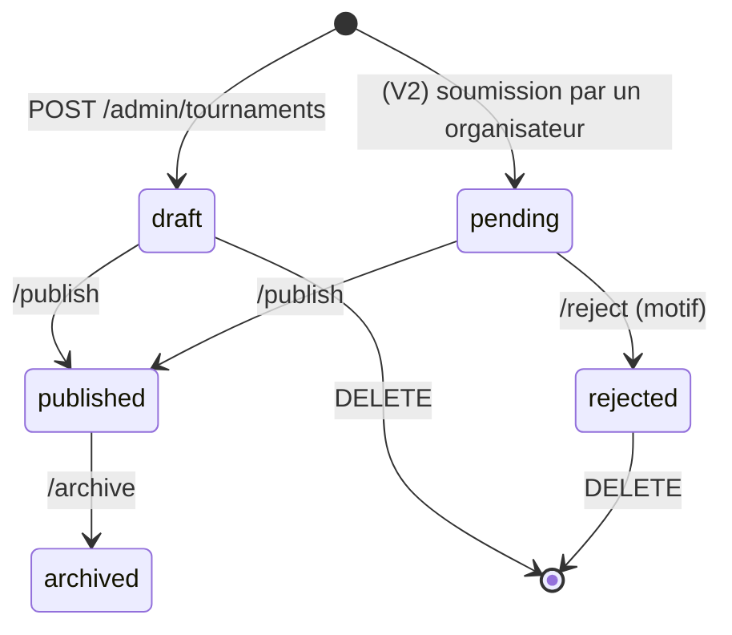
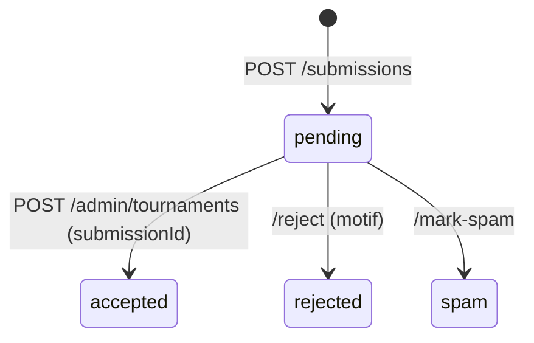

# Phase 2.3 — Contrat d'API REST

| | |
|---|---|
| **Version** | 1.0 — à valider |
| **Date** | 1er novembre 2026 |
| **Références** | [Cahier des charges v1.1](cahier-des-charges.md) · [Architecture 2.1](02-architecture.md) · [Modèle de données 2.2](03-modele-donnees.md) |
| **Contrat** | [`api/openapi.yaml`](../api/openapi.yaml) — OpenAPI 3.0.3, **59 opérations** |

> Ce document résume et explique le contrat. **La référence exacte est le fichier `openapi.yaml`** : c'est lui qui génère le code du serveur Go et les clients TypeScript.

---

## Sommaire

1. [Vérifications effectuées](#1-vérifications-effectuées)
2. [Consulter la documentation interactive](#2-consulter-la-documentation-interactive)
3. [Conventions](#3-conventions)
4. [Liste des endpoints](#4-liste-des-endpoints)
5. [Exemples](#5-exemples)
6. [Authentification et sessions](#6-authentification-et-sessions)
7. [Cycle de vie et transitions de statut](#7-cycle-de-vie-et-transitions-de-statut)
8. [Erreurs](#8-erreurs)
9. [Limitation de débit et anti-spam](#9-limitation-de-débit-et-anti-spam)
10. [Choix de conception](#10-choix-de-conception)
11. [Points à valider](#11-points-à-valider)

---

## 1. Vérifications effectuées

| Vérification | Outil | Résultat |
|---|---|---|
| Conformité OpenAPI 3.0.3 et bonnes pratiques | Redocly CLI (règles `recommended`) | ✅ Aucune erreur |
| Génération du serveur Go (types + interface stricte + routeur chi) | oapi-codegen v2 | ✅ Code généré, compile, `go vet` sans erreur |
| Génération du client TypeScript et utilisation en mode strict | openapi-typescript + openapi-fetch + `tsc --strict` | ✅ Compile |

Le test TypeScript a révélé un défaut de conception, corrigé avant livraison : les champs facultatifs des **réponses** pouvaient être à la fois absents et `null`. Désormais, **dans une réponse, tout champ est toujours présent** (valeur `null` s'il est vide), ce qui simplifie le code des clients.

---

## 2. Consulter la documentation interactive

Depuis la racine du dépôt :

```bash
npx @redocly/cli preview-docs api/openapi.yaml
```

Puis ouvrir l'adresse affichée (http://127.0.0.1:8080). Vous y verrez chaque endpoint, ses paramètres, ses schémas et des exemples. En phase 3, cette documentation sera aussi servie par le backend sur `/docs`.

Vérifier le contrat après une modification :

```bash
npx @redocly/cli lint api/openapi.yaml --config api/redocly.yaml
```

---

## 3. Conventions

| Sujet | Règle |
|---|---|
| Version | Préfixe `/v1`. Une rupture de compatibilité donnera `/v2` ; ajouter un champ ou un endpoint n'en est pas une. |
| Format | JSON, champs en `camelCase` |
| Dates | `"2027-06-14"` (date locale) ; heures `"09:30"` ; horodatages ISO 8601 en UTC (`"2027-05-02T08:15:00Z"`) |
| Identifiants | UUID |
| Montants | Entiers en **centimes** (`1500` = 15,00 €) |
| Référentiels | Seuls les **codes** circulent (`"2x2"`, `"sand"`). Les libellés français sont fournis une fois par `GET /v1/reference` |
| Champs vides | **Réponses** : toujours présents, `null` si vides. **Requêtes** : un champ facultatif peut être omis |
| Listes | Pagination par curseur : `?limit=20&cursor=…` → `{ "items": […], "nextCursor": "…" }` (`null` = dernière page) |
| Filtres multiples | Paramètre répété = « l'un ou l'autre » : `?department=29&department=56` |
| Actions métier | `POST /ressource/{id}/action` (`/publish`, `/reject`, `/archive`…) plutôt que de modifier un statut à la main : chaque action vérifie ses règles et laisse une trace dans l'historique |
| Idempotence | `PUT` et `DELETE` des favoris peuvent être rejoués sans effet de bord |
| Concurrence | Modification d'un tournoi avec `version` (= `updatedAt` lu) : `409` si quelqu'un d'autre l'a modifié entre-temps |
| Cache | `GET /v1/reference` : `Cache-Control` + `ETag` |

---

## 4. Liste des endpoints

🔓 public · 👤 utilisateur connecté · 🔑 administrateur · 🔓/👤 public, enrichi si connecté

### Système et référentiels

| Méthode | Chemin | Accès | Rôle |
|---|---|:-:|---|
| GET | `/healthz` | 🔓 | Le service répond (sonde Cloud Run) |
| GET | `/readyz` | 🔓 | Le service et la base sont disponibles |
| GET | `/v1/reference` | 🔓 | Toutes les listes de valeurs (formats, niveaux, terrains, badges, départements…) |
| GET | `/v1/cities?q=` | 🔓 | Auto-complétion des communes (nom ou code postal) |

### Tournois, organisateurs, contributions

| Méthode | Chemin | Accès | Rôle | User story |
|---|---|:-:|---|---|
| GET | `/v1/tournaments` | 🔓 | Liste, recherche et filtres (`period`, `q`, `department`, `from`, `to`, `format`, `category`, `level`, `surface`, `organizerId`) | DEC-01 à 05 |
| GET | `/v1/tournaments/{id}` | 🔓 | Fiche détaillée, avec tableaux et autres éditions | FIC-01 à 09 |
| POST | `/v1/tournaments/{id}/events` | 🔓 | Compter une vue ou un clic « S'inscrire » (anonyme) | FIC-03, ADM-09 |
| POST | `/v1/tournaments/{id}/reports` | 🔓/👤 | Signaler une erreur | CTB-02 |
| GET | `/v1/organizers/{id}` | 🔓 | Fiche organisateur | FIC-09 |
| POST | `/v1/submissions` | 🔓/👤 | Proposer un tournoi | CTB-01 |
| POST | `/v1/media` | 🔓/👤 | Envoyer une image (affiche de proposition sans compte ; affiche ou logo pour l'admin) | CTB-01, ADM-05 |

### Authentification et compte

| Méthode | Chemin | Accès | Rôle | User story |
|---|---|:-:|---|---|
| POST | `/v1/auth/register` | 🔓 | Créer un compte | CPT-01 |
| POST | `/v1/auth/login` | 🔓 | Se connecter | CPT-02 |
| POST | `/v1/auth/refresh` | 🔓 | Renouveler la session (rotation du jeton) | CPT-02 |
| POST | `/v1/auth/logout` | 🔓 | Se déconnecter | CPT-02 |
| POST | `/v1/auth/verify-email` | 🔓 | Confirmer l'e-mail | CPT-01 |
| POST | `/v1/auth/resend-verification` | 👤 | Renvoyer l'e-mail de vérification | CPT-01 |
| POST | `/v1/auth/forgot-password` | 🔓 | Demander un lien de réinitialisation | CPT-03 |
| POST | `/v1/auth/reset-password` | 🔓 | Définir un nouveau mot de passe | CPT-03 |
| GET | `/v1/me` | 👤 | Mon profil | CPT-05 |
| PATCH | `/v1/me` | 👤 | Modifier pseudo / département préféré | CPT-05 |
| PUT | `/v1/me/password` | 👤 | Changer de mot de passe | — |
| POST | `/v1/me/account-deletion` | 👤 | Supprimer définitivement mon compte | CPT-04 |
| GET | `/v1/me/favorites` | 👤 | Mes favoris (à venir / passés) | FAV-03 |
| GET | `/v1/me/favorites/ids` | 👤 | Identifiants de mes favoris (cœurs dans les listes) | FAV-01 |
| PUT | `/v1/me/favorites/{id}` | 👤 | Ajouter un favori | FAV-01 |
| DELETE | `/v1/me/favorites/{id}` | 👤 | Retirer un favori | FAV-01 |

### Administration

| Méthode | Chemin | Rôle | User story |
|---|---|---|---|
| GET | `/v1/admin/dashboard` | Indicateurs (propositions, signalements, tournois à vérifier…) | ADM-10 |
| GET | `/v1/admin/tournaments` | Tous les tournois, filtres par statut, « non vérifiés » | ADM-04 |
| POST | `/v1/admin/tournaments` | Créer un brouillon (série et lieu existants ou créés à la volée ; accepte une proposition) | ADM-02, ADM-07 |
| GET | `/v1/admin/tournaments/{id}` | Tournoi complet (champs internes inclus) | ADM-04 |
| PUT | `/v1/admin/tournaments/{id}` | Modifier (tableaux compris) | ADM-04 |
| DELETE | `/v1/admin/tournaments/{id}` | Supprimer un tournoi jamais publié | ADM-04 |
| POST | `/v1/admin/tournaments/{id}/publish` | Publier | ADM-04 |
| POST | `/v1/admin/tournaments/{id}/reject` | Refuser (avec motif) | ADM-07 |
| POST | `/v1/admin/tournaments/{id}/archive` | Archiver | ADM-04 |
| POST | `/v1/admin/tournaments/{id}/verify` | Confirmer que les informations sont à jour | RG-07 |
| POST | `/v1/admin/tournaments/{id}/duplicate` | Créer l'édition suivante | ADM-03 |
| GET | `/v1/admin/tournaments/{id}/stats` | Vues et clics par jour | ADM-09 |
| GET | `/v1/admin/tournaments/{id}/history` | Historique des modifications | ADM-04 |
| GET | `/v1/admin/duplicate-candidates` | Doublons probables pendant la saisie | RG-10 |
| GET | `/v1/admin/series` | Rechercher une série | ADM-02 |
| PATCH | `/v1/admin/series/{id}` | Renommer une série / changer d'organisateur | — |
| GET / POST | `/v1/admin/organizers` | Lister / créer des organisateurs | ADM-06 |
| GET / PUT / DELETE | `/v1/admin/organizers/{id}` | Consulter / modifier / supprimer (si sans tournoi) | ADM-06 |
| GET / POST | `/v1/admin/venues` | Rechercher / créer un lieu | ADM-02 |
| PUT | `/v1/admin/venues/{id}` | Modifier un lieu | ADM-02 |
| GET | `/v1/admin/geocode?q=` | Suggestions d'adresses géocodées (API Adresse) | ADM-02 |
| GET | `/v1/admin/submissions` | File des propositions | ADM-07 |
| GET | `/v1/admin/submissions/{id}` | Détail (avec doublons probables) | ADM-07 |
| POST | `/v1/admin/submissions/{id}/reject` | Refuser | ADM-07 |
| POST | `/v1/admin/submissions/{id}/mark-spam` | Classer indésirable | ADM-07 |
| GET | `/v1/admin/reports` | File des signalements | ADM-08 |
| POST | `/v1/admin/reports/{id}/resolve` | Marquer traité | ADM-08 |
| POST | `/v1/admin/reports/{id}/dismiss` | Rejeter | ADM-08 |

**Couverture** : chaque user story « M » du cahier des charges est servie par au moins un endpoint.

---

## 5. Exemples

### 5.1 Rechercher les tournois 2x2 sur sable dans le Finistère et le Morbihan

```http
GET /v1/tournaments?department=29&department=56&format=2x2&surface=sand&limit=20
```

```json
{
  "items": [
    {
      "id": "40000000-0000-0000-0000-000000000003",
      "name": "Tournoi de la Grande Plage",
      "startDate": "2027-06-12",
      "endDate": "2027-06-13",
      "startTime": "10:00",
      "city": { "inseeCode": "56034", "name": "Carnac", "departmentCode": "56" },
      "venueName": "Grande Plage",
      "organizerName": "Comité des fêtes de Carnac",
      "poster": null,
      "divisionSummary": {
        "formats": ["2x2", "4x4"],
        "categories": ["men", "women", "mixed"],
        "levels": ["beginner", "leisure", "intermediate", "advanced"],
        "surfaces": ["sand"],
        "minPriceCents": 0
      },
      "tags": [],
      "registrationStatus": "not_open_yet",
      "eventStatus": "scheduled",
      "postponedToDate": null,
      "closingSoon": false,
      "isPast": false
    }
  ],
  "nextCursor": null
}
```

`poster: null` → l'application affiche le visuel générique « sable » (RG-12).

### 5.2 Créer un tournoi depuis le back-office

```http
POST /v1/admin/tournaments
Authorization: Bearer eyJhbGciOi…
Content-Type: application/json
```

```json
{
  "newSeries": { "organizerId": "10000000-0000-0000-0000-000000000002", "name": "Tournoi de la Grande Plage" },
  "venueId": "20000000-0000-0000-0000-000000000002",
  "name": "Tournoi de la Grande Plage",
  "startDate": "2027-06-12",
  "endDate": "2027-06-13",
  "startTime": "10:00",
  "registrationMode": "on_site",
  "registrationInstructions": "Inscriptions sur place à partir de 9 h.",
  "registrationStatus": "not_open_yet",
  "eventStatus": "scheduled",
  "tags": ["solidarity"],
  "divisions": [
    {
      "format": "2x2", "category": "men", "surface": "sand",
      "levels": ["intermediate", "advanced"],
      "playersPerTeamMin": 2, "playersPerTeamMax": 2,
      "priceCents": 1000, "priceUnit": "player", "maxTeams": 32,
      "scheduleNote": "Samedi"
    },
    {
      "format": "4x4", "category": "mixed", "surface": "sand",
      "levels": ["beginner", "leisure"],
      "playersPerTeamMin": 4, "playersPerTeamMax": 5,
      "priceCents": 0, "maxTeams": 16,
      "scheduleNote": "Dimanche"
    }
  ]
}
```

Réponse `201` : le tournoi complet en **brouillon**. Il sera visible dans l'application après `POST …/publish`.

### 5.3 Erreur de validation

```json
{
  "type": "https://volleyspot.app/errors/validation",
  "title": "Données invalides",
  "status": 422,
  "code": "validation_failed",
  "detail": "2 champs sont invalides.",
  "errors": [
    { "field": "registrationUrl", "message": "obligatoire lorsque registrationMode vaut external_link" },
    { "field": "divisions[1].priceUnit", "message": "obligatoire pour un tableau payant" }
  ],
  "requestId": "c0a8012e-5b1f-4a7e-9f21-2d0b6c1e8a44"
}
```

---

## 6. Authentification et sessions

| | Application mobile (`client: "mobile"`, défaut) | Back-office web (`client: "web"`) |
|---|---|---|
| Jeton d'accès (15 min) | Corps de la réponse → mémoire | Corps de la réponse → mémoire |
| Jeton de renouvellement (30 j) | Corps de la réponse → `expo-secure-store` | **Cookie `HttpOnly`, `Secure`, `SameSite=Strict`**, jamais lisible par JavaScript |
| Renouvellement | `POST /v1/auth/refresh` avec `refreshToken` dans le corps | `POST /v1/auth/refresh` sans corps (cookie envoyé automatiquement) |

Règles de sécurité appliquées par l'API :

- `forgot-password` répond toujours `202`, que l'e-mail existe ou non.
- `login` répond `401` avec le même message pour « e-mail inconnu » et « mot de passe faux ».
- Réutiliser un jeton de renouvellement déjà échangé **révoque toute la session** (signe de vol).
- Changer ou réinitialiser son mot de passe révoque les autres sessions.
- Toutes les routes `/v1/admin/*` exigent le rôle `admin` (`403` sinon) — vérifié par des tests automatiques en phase 3.

---

## 7. Cycle de vie et transitions de statut

### Publication d'un tournoi (RG-03)



Toute autre transition renvoie `409` (code `invalid_transition`). Le déroulement (`eventStatus` : prévu / reporté / annulé) et les inscriptions (`registrationStatus`) se modifient librement via `PUT`, car ce sont des informations, pas des étapes de validation.

### Propositions (RG-09)



**Accepter une proposition** = créer le tournoi avec `submissionId` : le back-office pré-remplit le formulaire avec les données proposées, l'administrateur complète, et la création marque la proposition « acceptée » dans la même transaction. Il n'y a donc jamais de proposition acceptée sans tournoi.

### Signalements (RG-11)

`open` → `resolved` (fiche corrigée) ou `dismissed` (information exacte).

---

## 8. Erreurs

Toutes les erreurs suivent la RFC 9457 (`Content-Type: application/problem+json`), avec un `code` stable que les clients peuvent tester et un `requestId` à communiquer en cas de bug.

| HTTP | `code` | Cas |
|---|---|---|
| 400 | `bad_request` | JSON mal formé |
| 401 | `unauthenticated` | Jeton absent, invalide ou expiré |
| 401 | `invalid_credentials` | E-mail ou mot de passe incorrect |
| 403 | `forbidden` | Rôle insuffisant |
| 404 | `not_found` | Ressource inexistante (ou tournoi non publié côté public) |
| 409 | `conflict` | E-mail déjà utilisé, organisateur en double, organisateur encore utilisé |
| 409 | `version_conflict` | Le tournoi a été modifié entre-temps |
| 409 | `invalid_transition` | Changement de statut interdit |
| 410 | `token_expired` | Lien de vérification ou de réinitialisation expiré ou déjà utilisé |
| 413 | `payload_too_large` | Image > 10 Mo |
| 415 | `unsupported_media_type` | Fichier qui n'est pas une image JPEG/PNG/WebP |
| 422 | `validation_failed` | Champ invalide (détail dans `errors`) |
| 429 | `rate_limited` | Trop de requêtes (`Retry-After` indique l'attente) |
| 500 | `internal_error` | Erreur inattendue (aucun détail technique divulgué) |
| 502 | `upstream_unavailable` | API Adresse indisponible |
| 503 | `unavailable` | Base de données indisponible |

---

## 9. Limitation de débit et anti-spam

Valeurs de départ, ajustables par configuration :

| Endpoint | Limite |
|---|---|
| `POST /v1/auth/login` | 10 tentatives / 15 min par IP et par e-mail |
| `POST /v1/auth/register` | 5 / heure par IP |
| `POST /v1/auth/forgot-password`, `resend-verification` | 3 / heure par e-mail |
| `POST /v1/submissions` | 5 / heure par IP |
| `POST /v1/tournaments/{id}/reports` | 10 / heure par IP |
| `POST /v1/media` sans compte | 10 / heure par IP |
| `POST /v1/tournaments/{id}/events` | 120 / minute par IP ; une seule vue comptée par IP, tournoi et heure |
| Reste de l'API | 300 / minute par IP |

Formulaires anonymes : champ **pot de miel** `website` (invisible pour un humain ; s'il est rempli, la requête est acceptée en apparence mais ignorée). Cloudflare Turnstile pourra être ajouté si du spam passe malgré tout.

---

## 10. Choix de conception

| # | Choix | Alternative écartée | Raison |
|---|---|---|---|
| A-01 | Codes de référentiels en **énumérations** dans le contrat | Chaînes libres | Les clients TypeScript ont des types exhaustifs (le compilateur signale un cas oublié). Contrepartie : ajouter une valeur demande une migration **et** une mise à jour du contrat, ce qui est voulu |
| A-02 | Libellés via `GET /v1/reference` | Libellés répétés dans chaque réponse | Réponses plus légères ; libellés modifiables sans redéployer les applications |
| A-03 | Upload d'image en deux temps (`POST /v1/media`, puis l'identifiant dans le formulaire) | Formulaire multipart unique | Même mécanisme partout (proposition, tournoi, logo) ; aperçu de l'image avant envoi du formulaire |
| A-04 | Statistiques par appel explicite (`/events`) | Compter chaque `GET` de la fiche | Ne compte pas les rechargements du back-office, les robots ni les préchargements |
| A-05 | Actions dédiées pour la publication | `PATCH { publicationStatus }` | Règles et traces d'audit explicites, transitions contrôlées |
| A-06 | `PUT` remplaçant tout le tournoi, tableaux compris | Endpoints séparés par tableau | Le formulaire du back-office enregistre tout d'un coup, de façon atomique |
| A-07 | Verrouillage optimiste (`version`) | Dernier qui enregistre gagne | Évite d'écraser une correction faite dans un autre onglet |
| A-08 | Suppression de compte par `POST /v1/me/account-deletion` avec mot de passe | `DELETE /v1/me` | Certains clients HTTP suppriment le corps des `DELETE` ; la confirmation par mot de passe protège d'une suppression accidentelle |
| A-09 | Pas d'endpoint d'administration des utilisateurs au MVP | Gestion des comptes dans le back-office | Pas de besoin identifié ; le compte administrateur sera créé par une commande en ligne |

---

## 11. Points à valider

1. **Liste des endpoints** (section 4) : rien ne manque, rien n'est en trop pour le MVP ? → OK ?
2. **Acceptation d'une proposition** en créant le tournoi avec `submissionId` (section 7). → OK ?
3. **Limites de débit** de départ (section 9). → OK ?
4. **Pas de gestion des utilisateurs** dans le back-office au MVP (A-09). → OK ?

Après validation : **2.4 — Navigation, wireframes et charte graphique**. Ce sera la dernière étape de la conception avant le démarrage du développement (phase 3).
